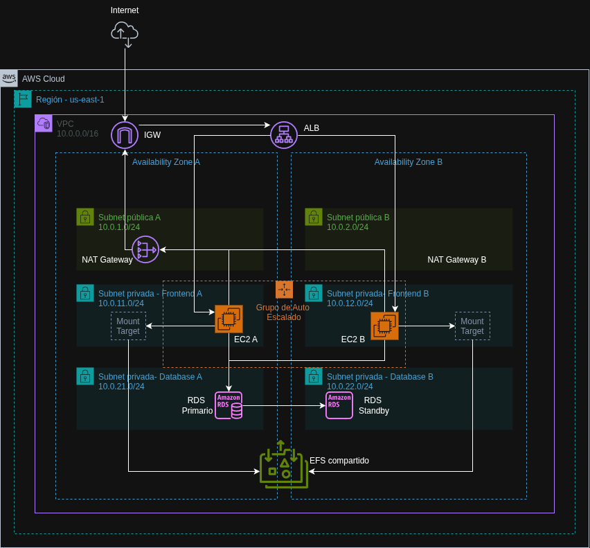

# AWS WordPress High Availability Infrastructure

## 1. Project Overview

This project implements a WordPress infrastructure on **Amazon Web Services (AWS)** using AWS Academy Learner Lab.

The architecture was designed to demonstrate fundamental cloud infrastructure concepts, including high availability, network segmentation, application scalability, shared storage, and database redundancy.

The infrastructure is deployed in the **US East (N. Virginia) Region (`us-east-1`)**, across two Availability Zones.

The project uses containerized WordPress application instances managed by an EC2 Auto Scaling Group, an internet-facing Application Load Balancer, Amazon EFS for shared storage, and Amazon RDS for MySQL with Multi-AZ deployment.

The implementation considers the resource limitations and restrictions of the AWS Academy Learner Lab environment.

## 2. Architecture

The infrastructure follows a segmented network architecture within a dedicated VPC.

### Main Components

| Component | Purpose |
|---|---|
| Amazon VPC | Provides an isolated network environment. |
| Public Subnets | Host the Application Load Balancer, NAT Gateway, and temporary administrative EC2 instance. |
| Private Application Subnets | Host WordPress application instances. |
| Private Database Subnets | Isolate the Amazon RDS database deployment. |
| Application Load Balancer | Distributes incoming HTTP traffic across healthy application instances. |
| EC2 Auto Scaling Group | Manages WordPress application instances using a custom AMI and Launch Template. |
| Docker and Docker Compose | Run and manage the WordPress application containers. |
| Amazon RDS for MySQL | Provides managed relational database services with Multi-AZ availability. |
| Amazon EFS | Provides shared persistent storage for WordPress media, plugins, and themes. |
| NAT Gateway | Provides outbound internet connectivity for private application instances. |

### Architecture Diagram



A light version of the architecture diagram is also available:

[AWS WordPress Architecture](diagrams/aws-wordpress-ha-arch-light.drawio.png)


## 3. Technologies and AWS Services

### AWS Services

- Amazon VPC
- Amazon EC2
- EC2 Auto Scaling
- Application Load Balancer (ALB)
- Amazon RDS for MySQL
- Amazon Elastic File System (EFS)
- AWS Identity and Access Management (IAM)
- AWS Key Management Service (KMS)
- Internet Gateway
- NAT Gateway
- Amazon CloudWatch

### Application and Infrastructure Technologies

- WordPress
- Docker
- Docker Compose
- Amazon Linux 2023
- MySQL 8.4
- PHP 8.3
- Apache HTTP Server

## 4. Key Implementation Features

- **Network segmentation:** Six subnets distributed across two Availability Zones, separating public, application, and database resources.
- **Application distribution:** An internet-facing Application Load Balancer forwards incoming requests to private EC2 instances.
- **Automated provisioning:** A custom AMI and Launch Template allow the Auto Scaling Group to provision consistently configured WordPress instances.
- **Containerization:** WordPress runs inside Docker containers managed through Docker Compose.
- **Shared persistent storage:** Amazon EFS provides a common `wp-content` directory across application instances.
- **Database redundancy:** Amazon RDS Multi-AZ provides a primary database instance and a standby instance in a separate Availability Zone.
- **Data encryption:** Encryption at rest is enabled for RDS and EFS, while EFS also uses encryption in transit through TLS.
- **Restricted database access:** RDS is deployed in private subnets and accepts database connections from the application Security Group.

## 5. Security Considerations and Limitations

The project implements network isolation through private subnets and AWS Security Groups, restricting communication between infrastructure components according to their required services.

However, some configurations were simplified due to the academic scope and AWS Academy environment restrictions.

Known limitations include:

- HTTP-only access. HTTPS termination through AWS Certificate Manager was not configured.
- A single NAT Gateway is shared by both private application subnets, introducing a potential availability limitation.
- Database credentials are stored in a local `.env` file included in the custom AMI.
- EC2 application instances do not have associated IAM Roles or Instance Profiles.
- No additional host-based firewall configuration was implemented.
- Default Network ACL rules were retained.
- Advanced security monitoring services, including AWS WAF, Amazon GuardDuty, and AWS Config, were not implemented.

These decisions and their implications are documented in greater detail in `docs/security.md` and `docs/design-decisions.md`.

This implementation is intended for academic demonstration and is not presented as a fully production-ready deployment.

## 6. Repository Structure

The repository is organized to separate project documentation from architecture diagrams.

```text
aws-wordpress-ha/
│
├── docs/
│   ├── architecture.md
│   ├── infrastructure.md
│   ├── design-decisions.md
│   └── security.md
│
├── diagrams/
│   ├── aws-wordpress-ha-arch-dark.drawio.png
│   └── aws-wordpress-ha-arch-light.drawio.png
│
└── README.md
```

## 7. AI Assistance and Project Ownership

ChatGPT (standard chat version, not Agent Mode or ChatGPT Work) was used as an assistance tool throughout the project.

Its contributions included:

- Assistance with drafting and organizing the Markdown documentation.
- Technical guidance during infrastructure configuration.
- Support with developing and reviewing implementation commands and configuration code.
- Explanations of AWS services, architectural concepts, and troubleshooting procedures.

**All architectural decisions, technology selections, implementation activities, and project execution were performed by the author.**

ChatGPT served as a support and reference tool; responsibility for the design, implementation, and configuration of the infrastructure remained with the author.

## 8. Project Scope

This project was developed as an academic and practical exercise to apply cloud computing and infrastructure administration concepts using AWS.

The main objectives were to gain practical experience with:

- AWS networking and subnet segmentation.
- EC2 provisioning and automated instance management.
- Containerized application deployment.
- Load balancing and application availability.
- Managed relational databases and Multi-AZ deployments.
- Shared network file systems.
- Cloud infrastructure security and resource access management.
- Technical documentation and architectural decision-making.

The project also identifies the limitations of the implemented configuration and the additional improvements that would be required for a production environment.
