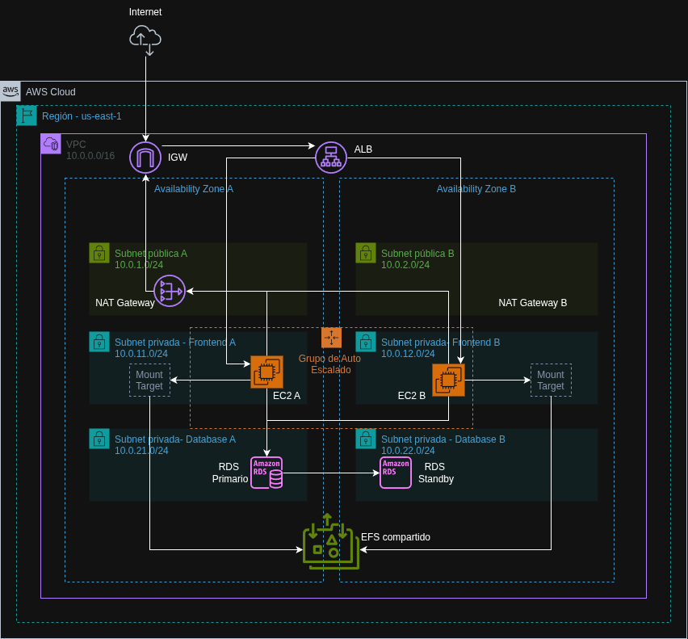
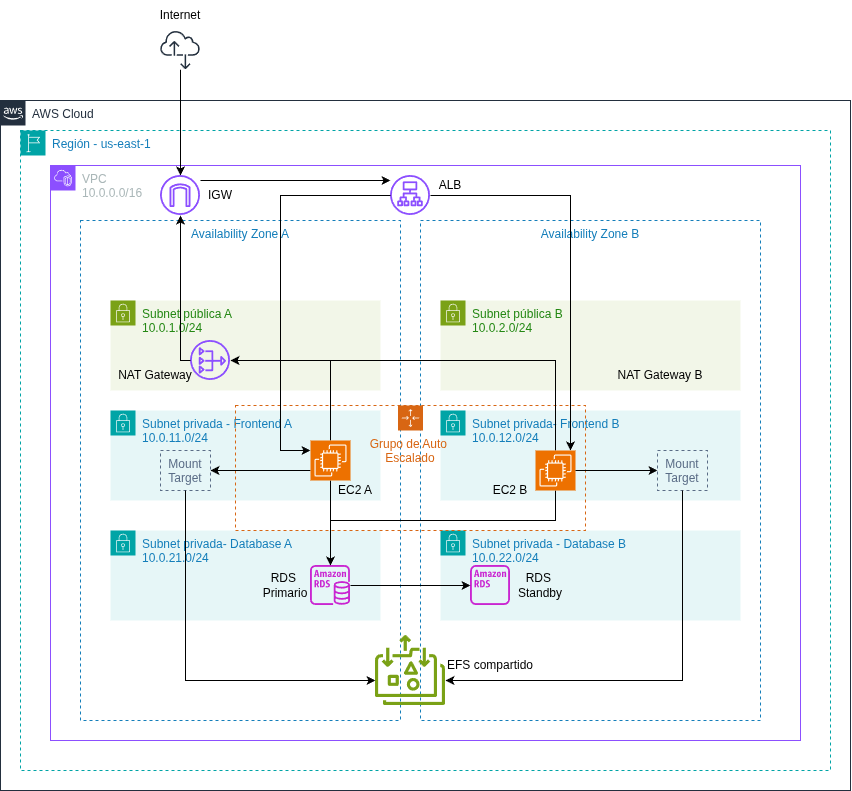

# Architecture Overview

This project implements a WordPress architecture designed to support high availability through multi-AZ deployment, shared storage, and database redundancy, while accounting for the resource and service limitations of the AWS Academy Learner Lab environment.

The project is deployed in the AWS US East (N. Virginia) Region (`us-east-1`), using a single Virtual Private Cloud (VPC) distributed across two Availability Zones:

- `us-east-1a` (`use1-az4`)
- `us-east-1b` (`use1-az6`)

The VPC contains six subnets, organized into three categories across both Availability Zones.

## Network Architecture

- **Public subnets:** Host the internet-facing Application Load Balancer (ALB) and a single NAT Gateway.
- **Private application subnets:** Host the WordPress EC2 instances managed by an Auto Scaling Group.
- **Private database subnets:** Host the Amazon RDS MySQL deployment, configured for Multi-AZ availability.

An Internet Gateway (IGW) provides internet connectivity to the VPC. The NAT Gateway enables outbound internet access from the private application subnets.

## Main Components

- **Application Load Balancer (ALB):** Receives incoming HTTP traffic and distributes requests across healthy EC2 instances.
- **NAT Gateway:** Provides outbound internet connectivity to instances in private subnets. Only one NAT Gateway is deployed in the architecture.
- **EC2 Auto Scaling Group:** Manages WordPress application instances across the two private application subnets. Instances are launched using a **custom Amazon Machine Image (AMI)** containing the preconfigured WordPress environment.
- **Docker:** Runs WordPress inside containers on each EC2 instance. Docker Compose manages the application service using the `wordpress:php8.3-apache` image.
- **Amazon RDS Multi-AZ:** Hosts the MySQL database using a primary instance and a standby instance in separate Availability Zones, providing automatic failover.
- **Amazon EFS:** Provides shared storage for WordPress media files, plugins, and themes, allowing application instances to access the same content.
- **EFS Mount Targets:** Enable connectivity between EC2 instances and the shared file system within the VPC.

## Traffic Flow

Incoming traffic reaches the Application Load Balancer through the Internet Gateway. The ALB forwards HTTP requests to healthy EC2 instances in the private application subnets through port 8080.

Each EC2 instance runs a WordPress Docker container that listens on port 80 internally and exposes port 8080 on the EC2 host.

The EC2 instances communicate with the RDS database and access shared files through Amazon EFS. EFS is mounted as persistent storage for the WordPress `wp-content` directory, allowing plugins, themes, and uploaded media to be shared across application instances.

Outbound internet connectivity from the private application subnets is provided through the NAT Gateway.

This architecture separates the application and database layers while distributing resources across two Availability Zones.

## Architecture Diagram

